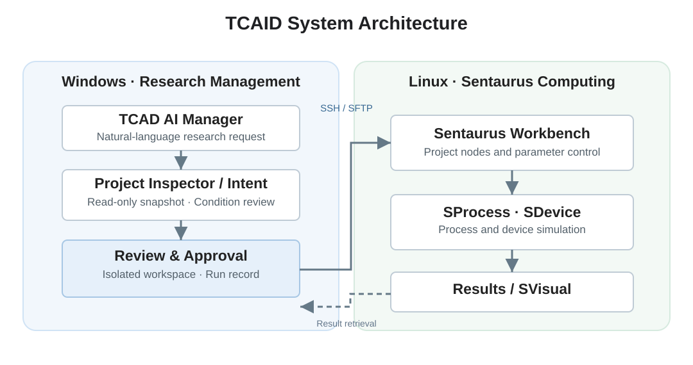
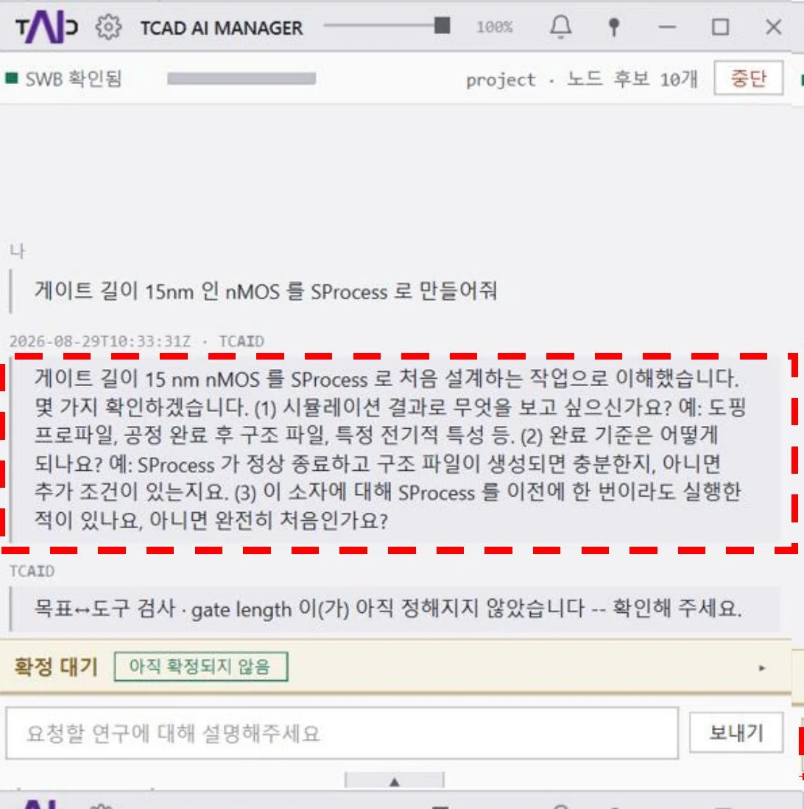
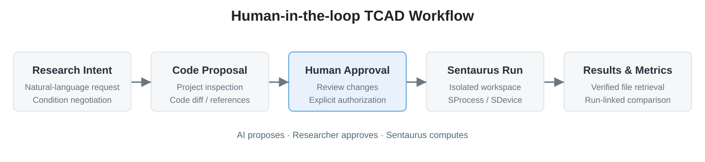
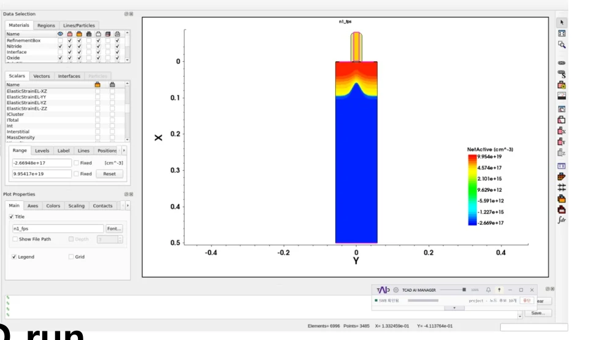
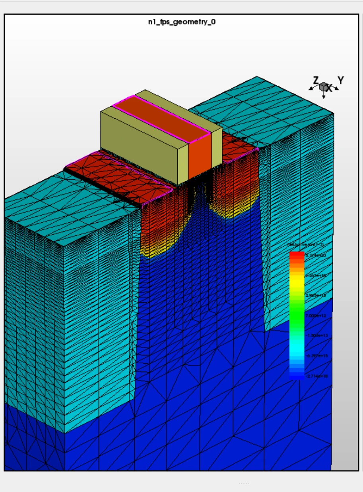
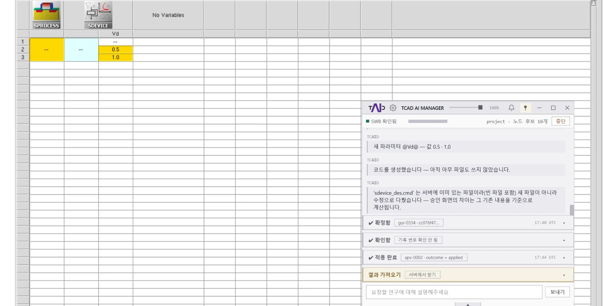
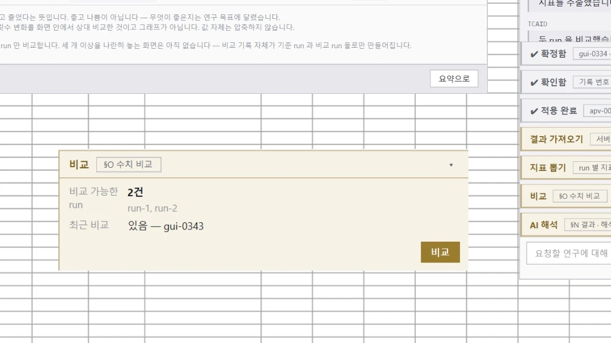
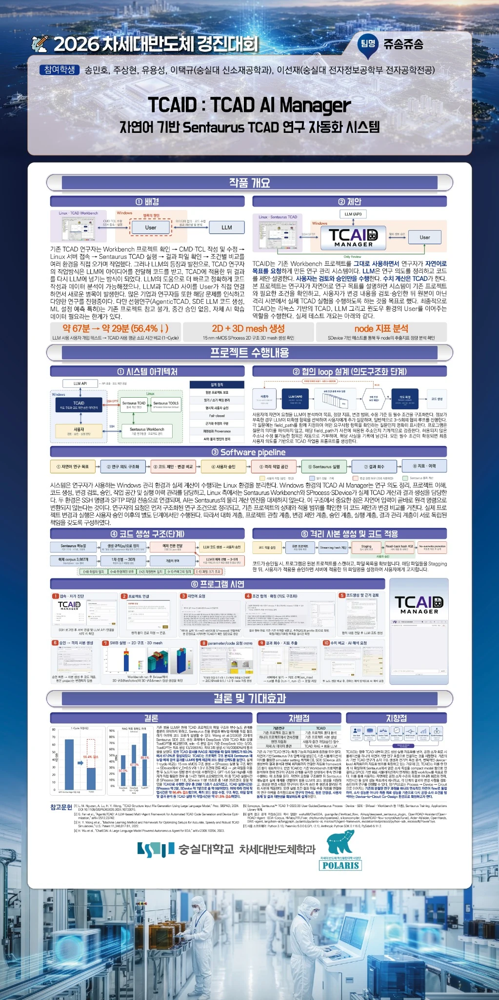

# TCAID : TCAD AI Manager

**자연어 기반 Sentaurus TCAD 연구 자동화 시스템**

TCAID는 연구자가 자연어로 실험 목적과 조건을 전달하면 기존 Sentaurus Workbench 프로젝트 확인, 연구 조건 협의, 코드 제안·검토, 사용자 승인, 격리 작업 공간 실행, 결과 회수 및 비교까지 지원하는 **Human-in-the-loop TCAD 연구 관리 시스템**입니다.

**Summary:** TCAID (TCAD AI Manager) is a human-in-the-loop research automation system that connects natural-language research intent, Synopsys Sentaurus Workbench project inspection, code review and approval, isolated execution, and traceable result management. The AI assists in specifying research conditions and proposing changes, while actual semiconductor process/device simulations are executed by Sentaurus under user control.

| 항목 | 내용 |
|---|---|
| 프로젝트 | TCAID : TCAD AI Manager |
| 분야 | Semiconductor TCAD · AI-assisted Research Automation · Software |
| 대회 | 2026 차세대반도체 경진대회 · 시스템/SW |
| 참여 | 숭실대학교 공동 개발팀 5인 |
| 담당 | 프로젝트 총괄, 설계·개발·발표 |
| 기술 | Python · Synopsys Sentaurus TCAD · Workbench · SProcess · SDevice · SVisual · SSH/SFTP |
| 소스코드 | [TCAD-AI-Manager](https://github.com/jujushmaterial/TCAD-AI-Manager) |
| 시연 영상 | [YouTube — TCAD AI Manager](https://www.youtube.com/watch?v=SZO0Ig2KbU4) |

## 프로젝트 개요

TCAD 연구에서는 Workbench 프로젝트 구조 확인, CMD/TCL 변경, Linux 서버 접속, Sentaurus 실행, 결과 파일 회수와 조건별 비교가 여러 환경에서 반복됩니다. LLM을 활용하더라도 연구자가 코드 생성 결과를 직접 전달하고 실행과 분석을 다시 연결해야 하므로 작업의 단절과 반복이 남습니다.

본 프로젝트는 기존 Sentaurus 환경을 대체하지 않고 **연구자의 의도를 실제 프로젝트와 연결하는 관리 계층**을 구축했습니다. AI는 연구 요구사항 정리 및 코드 제안을 담당하고, 연구자는 변경 내용을 검토·승인하며, 실제 수치 계산은 Sentaurus가 수행합니다.

## 개발 목표

- 기존 Workbench 프로젝트를 분석하여 적용 대상과 의존관계를 확인
- 미확정 조건을 자연어 대화로 구체화하고 사용자 결정과 AI 제안을 구분
- 코드 변경안, 참고 예제, 적용 범위를 사용자에게 제시하여 명시적 승인 확보
- 원본 프로젝트를 보호하고 격리 사본에서 실험 수행
- Windows 관리 환경과 Linux Sentaurus 계산 환경 연동
- 결과 파일과 실행 조건·지표·이력의 대응 관계 추적

## 시스템 설계



Windows 측 TCAID는 연구 요청, 프로젝트 관찰, 코드 검토, 사용자 승인 및 실행 이력 관리를 담당합니다. Linux 측 Sentaurus Workbench와 SProcess/SDevice/SVisual은 실제 공정·소자 시뮬레이션과 결과 생성을 담당하며 SSH/SFTP로 연결됩니다.

### 주요 설계 원칙

| 원칙 | 구현 방향 |
|---|---|
| Human-in-the-loop | 코드 제안과 실제 적용·실행 권한 분리 |
| 원본 보호 | 읽기 전용 프로젝트 분석과 격리된 작업 공간에서의 변경 |
| Fail-closed | 경로·승인·원격 작업 결과가 불확실할 때 실행 중단 |
| 근거와 추정 구분 | confirmed / suggested / assumed / unresolved / derived 상태 관리 |
| 재현성과 추적성 | ProjectSnapshot → Approval → Workspace → Run → Result → Metric 연결 |
| AI와 물리 엔진 분리 | AI가 생성한 설명과 실제 Sentaurus 계산 결과를 구분 |

## 주요 구현 내용

### 1. 기존 Workbench 프로젝트 이해

Project Inspector 계층에서 artifact, node·tool 후보, 의존관계와 미해결 항목을 구조화된 ProjectSnapshot으로 관리합니다. 기본 분석은 **metadata-only**이고 추가 파일 내용 분석은 명시적 선택과 읽기 제한을 적용합니다.

### 2. 자연어 연구 목표 구체화

연구자가 원하는 소자 구조·공정·도구·목표 지표를 요청하면 미확정 조건을 확인합니다. AI의 제안값을 사용자 확정값처럼 취급하지 않고, 조건이 정리된 뒤 코드 생성 단계로 진행합니다.

### 3. 코드 제안·검토·승인

변경 대상과 생성 코드, 참고 근거, diff를 제시하고 사용자가 명시적으로 승인합니다. 승인 범위·유효성·대상 불일치를 검사해 무단 변경을 차단하는 설계입니다.

### 4. 격리 작업 공간과 원본 보호

승인된 변경은 원본 Workbench 프로젝트가 아닌 별도 workspace에 적용합니다. 복사 및 전송 단계에는 무결성 확인과 불확실한 원격 작업 결과를 거부하는 안전 절차를 둡니다.

### 5. 결과 회수·지표·이력

SFTP로 결과를 회수하면서 파일 상태를 확인하고 결과·실행·지표를 연결합니다. 결과 추출 실패와 정상적인 수치 0을 구분하여 데이터의 출처를 관리합니다.

## 실제 시연






### SProcess 구조 생성

| 2D 구조 | 3D Mesh |
|---|---|
|  |  |


자연어 요청과 조건 확정으로 생성된 공정 코드를 격리 사본에 적용해 실행하였고, **SVisual에서 2D 구조 및 3D mesh가 생성된 결과**를 확인했습니다.

### SDevice 조건별 실험

| SDevice 실험 | 지표 수치 비교 |
|---|---|
|  |  |


Drain bias **Vd = 0.5 V / 1.0 V**를 서로 다른 Workbench node로 구성해 실행했습니다. 실행별 결과를 회수하고 **ion_max**를 추출하여 동일 지표의 수치를 비교했습니다.

### 프로그램 시연 영상

[▶ TCAD AI Manager — Program Demonstration](https://www.youtube.com/watch?v=SZO0Ig2KbU4)

시연은 Workbench 연결 → 자연어 조건 협의 → 코드 제안·승인 → 격리 사본 적용 → Sentaurus 실행 → 2D/3D 결과 확인 → SDevice 비교 → 결과 회수·지표 비교 순서로 진행됩니다.

## 검증 및 성과

| 검증 항목 | 경진대회 제출 보고서의 확인 결과 |
|---|---|
| 자동 테스트 | **4,307건 통과 / 3건 건너뜀 / 0건 실패** |
| 실환경 연결 | Windows–Linux SSH 연결 및 SFTP 회수 확인 |
| 원격 SDevice | 기본 실행 정상 종료 및 결과 파일 갱신 확인 |
| SProcess | 통합 시연에서 2D 구조·3D mesh 확인 |
| SDevice 조건별 실험 | Vd 조건 분기, 두 node 구성, ion_max 비교 |
| 작업시간 비교 | 포스터에 제시된 특정 1-Cycle 사례: 약 **67분 → 약 29분** |

자동 테스트, 실환경 동작 검증, 통합 GUI 시연은 서로 다른 검증 근거입니다. 구조 또는 mesh 생성 성공 자체가 소자의 물리적 타당성 검증을 의미하지는 않습니다.

## 기술적 차별성

단순한 자연어 코드 생성이 아닌 **프로젝트 이해 → 조건 협의 → 생성·검토 → 사용자 승인 → 격리 실행 → 결과·지표 관리**의 연결에 초점을 두었습니다. 이를 위해 읽기·쓰기 권한을 분리하고, 원본 프로젝트 및 실험 결과의 출처를 추적할 수 있도록 설계했습니다.

## 한계 및 확장 방향

실제 Sentaurus의 다양한 결과 형식(.plt, gvars.dat 및 변환 데이터)을 범용으로 분석하는 기능, 다중 실행의 물리 기반 AI 해석, parameter sweep과 수렴 진단, 자동 물리적 타당성 검증은 별도의 검증이 필요한 확장 범위입니다. 본 프로젝트의 성과는 **연구자가 통제권을 유지하는 자동화된 TCAD 작업 흐름**과 그 통합 시연에 있습니다.

## 공동 개발 및 역할

숭실대학교 **송민호, 주상현, 유용성, 이선재, 이택규**의 공동 프로젝트입니다. 본 포트폴리오는 프로젝트 총괄, 시스템 설계·개발 및 결과 발표를 담당한 관점에서 연구 흐름과 설계 의도를 정리했습니다. 팀 전체의 구현·검증 성과와 개인 기여는 구분해 기록했습니다.

## 발표 결과

**2026 차세대반도체 경진대회 · 시스템/SW 분야 · 최우수상**

[](assets/figures/tcaid_poster.jpg)

## 참고 자료

- [TCAID 프로그램 저장소](https://github.com/jujushmaterial/TCAD-AI-Manager)
- [TCAID 프로그램 시연 영상](https://www.youtube.com/watch?v=SZO0Ig2KbU4)
- [연구 보고서와 그림의 근거](docs/SOURCE_MAPPING.md)
- [그림 출처 관리](docs/FIGURE_PROVENANCE.md)

## Repository Structure

```text
TCAID-portfolio/
├── README.md
├── index.html
├── .nojekyll
├── assets/
│   ├── css/
│   │   ├── project-v2.css
│   │   └── tcaid.css
│   └── figures/
│       ├── tcaid_logo.svg
│       ├── system_architecture.svg
│       ├── research_workflow.svg
│       ├── logo.webp / intent.webp / approval.webp / workspace.webp
│       ├── mos2d.webp / mos3d.webp / sdevice.webp
│       ├── metric.webp / compare.webp / provenance.webp / safety.webp
│       └── tcaid_poster.jpg / poster.webp
└── docs/
    ├── FIGURE_PROVENANCE.md
    └── SOURCE_MAPPING.md
```
